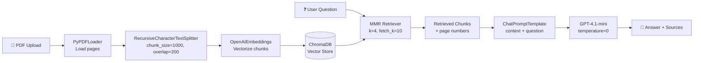

# 📚 RAG Project — Document Reader

A Retrieval-Augmented Generation (RAG) app that reads PDF books and answers questions about them — in a chat UI or from the terminal.

## ✨ Features

- Upload any PDF and build a searchable knowledge base
- Chat-style Q&A with conversation history (Streamlit UI)
- CLI mode for quick terminal questions (`main.py`)
- Answers come **only** from the document — no hallucinations
- Every answer shows its **retrieved sources with page numbers**, so you can verify it
- MMR retrieval for diverse, non-repetitive context chunks

## 🏗️ Architecture



## 📁 Project Structure

```
├── app.py                  # Streamlit chat UI — "Book RAG Assistant"
├── main.py                 # CLI version — ask questions from the terminal
├── create_database.py      # One-shot script: builds the ChromaDB from a PDF
├── requirements.txt
├── document loaders/       # Loading experiments: PyPDFLoader, TokenTextSplitter,
│                           # RecursiveCharacterTextSplitter
├── retrievers/             # Retrieval experiments: MMR, multi-query, arXiv
└── vector store/           # ChromaDB basics: store, similarity search, retriever
```

## 🚀 Quickstart

```bash
pip install -r requirements.txt
```

Create a `.env` file with your key:

```
OPENAI_API_KEY=your_key_here
```

**Option 1 — Chat UI:**

```bash
streamlit run app.py
```

Upload a PDF in the sidebar → click **Create Knowledge Base** → start asking questions.

**Option 2 — Terminal:**

```bash
python create_database.py   # builds chroma-db from the PDF
python main.py              # ask questions (type 0 to exit)
```

## 🧠 Design Decisions

| Choice | Why |
|---|---|
| **MMR retrieval** (not plain similarity) | Plain top-k often returns 4 near-identical chunks. MMR balances relevance with diversity, so the context covers more of the document. |
| **Chunk size 1000 / overlap 200** | 1000 chars holds a full idea; the 200-char overlap keeps sentences from being cut mid-thought at chunk boundaries. |
| **temperature = 0** | This is a factual Q&A task — zero temperature makes answers deterministic and faithful to the source. |
| **"Answer using ONLY the context"** system prompt | Forces the model to say *"I could not find the answer in the document"* instead of hallucinating. |
| **Source page numbers in the UI** | Every answer is verifiable — the user can open the PDF and check the exact page. |
| **ChromaDB persisted locally** | No separate database server needed; the vector store lives in `chroma-db/` and rebuilds with one script. |

## 🛠️ Tech Stack

Python · LangChain · Streamlit · ChromaDB · OpenAI (Embeddings + GPT-4.1-mini) · PyPDF
